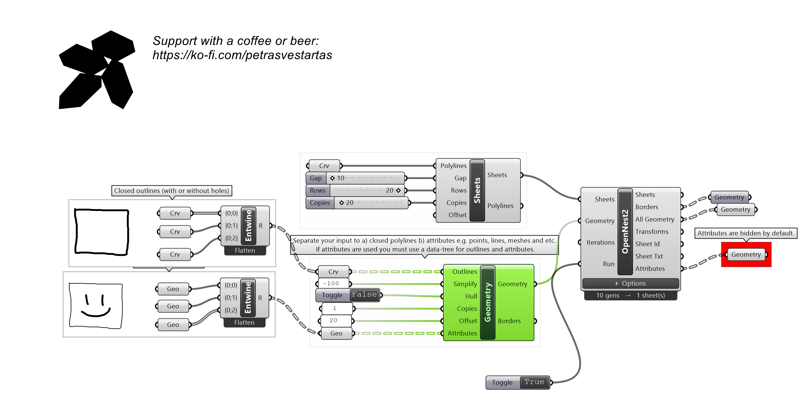
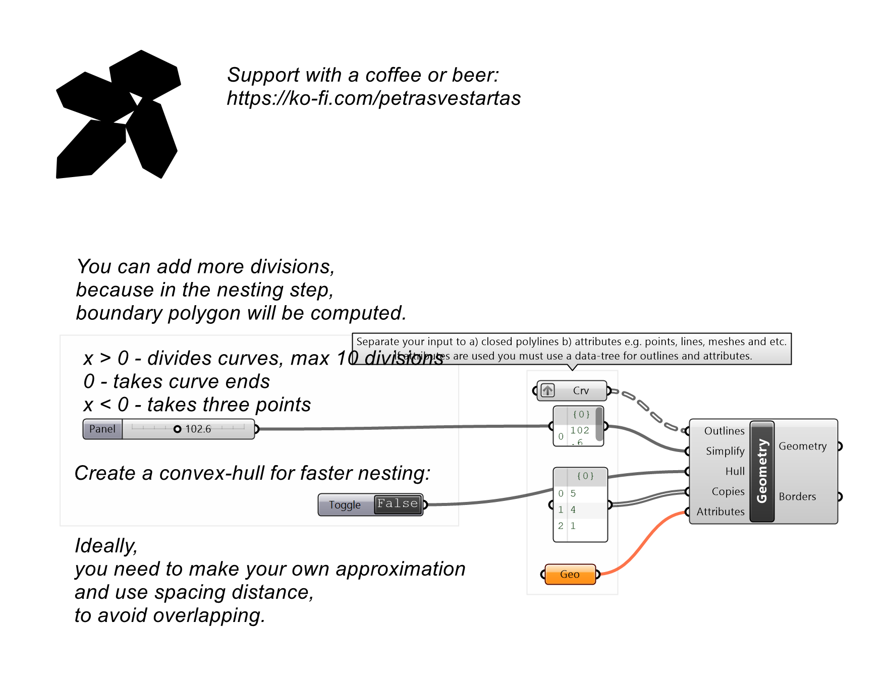
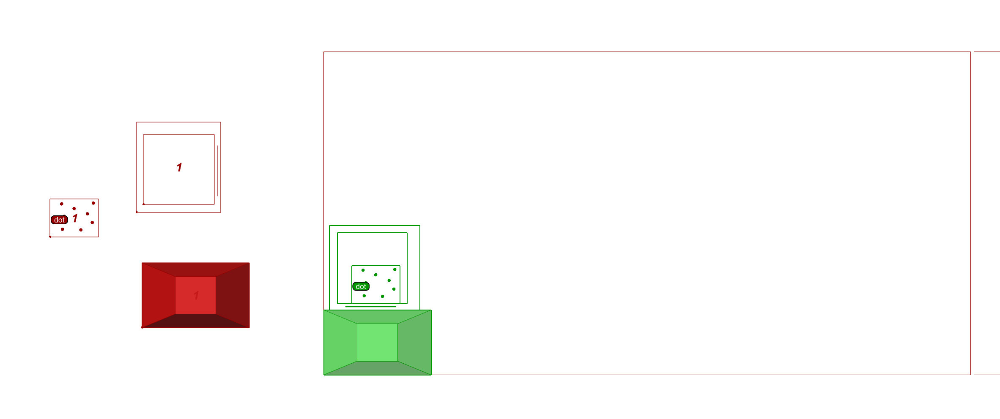
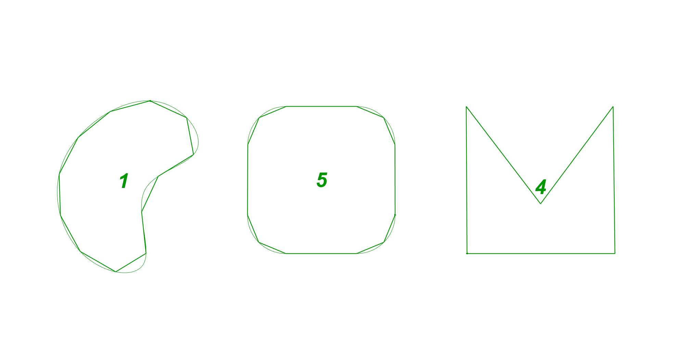

# Geometry

Prepares parts for nesting: separates outlines (with holes) from attached attributes; optional simplify, convex hull and copies.

## Example

**Files to download:**

- [⬇ geometry.ghx](files/geometry/geometry.ghx)

## Inputs

| Parameter | Type | Access | Description |
| --- | --- | --- | --- |
| **Outlines** | Geometry | tree | Closed curves OR planar surfaces (cast per type internally). If geometries have holes, create a data-tree first.  Place each element into indivdual branch.  Otherwise the algoritm will try to order polylines by checking possible holes. |
| **Simplify** | Number | item | segment divisions  0 = KEEP ALL vertices (no simplification - best for nesting fine outlines)  x>0 divides by distance  x<0 max 3 points per sub-segment (merges colinear within 10deg) _Default: -100._ |
| **Hull** | Boolean | item | Replace each outline with its convex hull _Default: false._ |
| **Copies** | Integer | list | Number of copies per part |
| **Offset** | Number | item | Clearance offset for NESTING only (model units; 0 = OFF, fast). Parts: outer grows / holes shrink so placed parts keep this gap. The ORIGINAL curves are still what get placed/output. _Default: 0._ |
| **Rotations** | Integer | list | OPTIONAL per-part rotation constraint (one value per part, repeats like Copies). Empty / 0 = part inherits the solver's global Rotations setting (default). N > 0 = THIS part may only use N orientations (360/N degree steps). 1 = fixed, no rotation (e.g. grain direction). Lets rectangular parts stay at 4 orientations while freeform parts rotate freely in ONE nest. Works with both OpenNest2 and OpenNestCollision. |
| **Attributes** | Geometry | tree | Additional geometry: points, lines, surfaces, meshes...  Use data-tree, one list of additional geometry per branch.. |

## Outputs

| Parameter | Type | Description |
| --- | --- | --- |
| **Geometry** | Generic | Prepared parts ready for nesting |
| **Borders** | Curve | Outline border curves per part |

## Curve sampling

Curved edges are sampled with chords that stay on the true curve, and the largest allowed chord deviation is capped at 3.5e-6 of the largest outline bounding-box diagonal in the input (e.g. 0.02 mm when the biggest part is a 5.7 m plate, never below the model tolerance), so long shallow arcs no longer force a millimetre-scale outward allowance around the whole part; with Simplify < 0, straight runs are then simplified by Ramer-Douglas-Peucker at that same deviation (curve samples are kept).

The clearance **Offset** is applied as a round (exact) offset: outers grow and holes shrink by the Minkowski sum with a disk of that radius (fillet chords within clamp(0.4% of the offset, 0.01 mm, 0.05 mm) of the true arc), so convex corners get exactly the requested gap instead of the larger mitre tip; sheet margins keep sharp corners.
